<div align="center">


# Lumo

**A tiny friend that lives at the top of your screen on Windows and keeps an eye on your AI coding agent sessions.**

Approve permissions, watch your agents work, drop a file, chat with Claude, Codex, Gemini or a local model, give your agents tools of your own, keep an eye on your timers, music, calendar and email — all without leaving what you're doing.

[](https://github.com/Rccrd12/Lumo/releases)


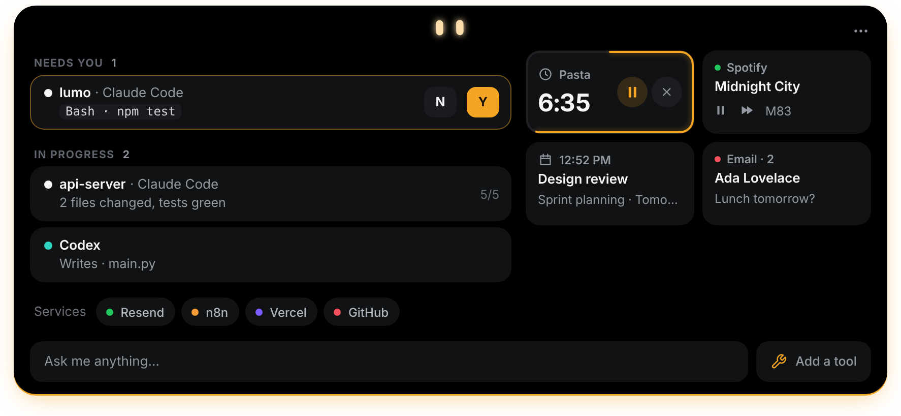


</div>

---

The full documentation of the app is in [`windows/README.md`](windows/README.md).

Meet **Lumo**: two bright eyes at the top of your screen. The island they live in peeks out of the edge when you need it, its light running along the border in the colour of what is going on, and it tells you the moment Claude Code needs you. Open it and everything is on one home: what waits for you, the sessions at work, your timers, music, calendar and email, and the field to the chat.

## Features

### Your agents

- 🤖 **Claude Code, Codex, Copilot CLI, Muse Code, Antigravity (IDE and CLI), Cursor, OpenCode, Amp, Hermes, Claude Desktop and other agents, live** — every session on the home, by its title: what it reads, edits and runs, step by step, and a green **Done** when it finishes. Tag a hook payload with `lumo_agent` to give any agent its own pill (see [`docs/AGENTS.md`](docs/AGENTS.md)). Each file edit shows its name and +N −M counts; a click opens the full diff.
- ✅ **Approve and answer from the island** — permission requests come up with two big buttons, **Deny** and **Allow** (or `N` and `Y`), for Claude Code (from any terminal, or the Claude desktop app), Codex, Copilot CLI, Muse Code, OpenCode and Antigravity (the commands none of its own rules covers, with **Reply in Antigravity** to answer there instead), with **Allow for this session** underneath to let the same command, file or URL through until that session ends. `AskUserQuestion` prompts show the choices right in the island. Answer in the terminal instead and the card goes away. Nothing is ever allowed without your click.
- 🗺️ **Plans you can read before they start** — when an agent asks to start a plan, its steps show as a numbered list, with **Keep planning** and **Approve the plan** (or write what to change), and **Approve and let it edit files without asking** under them. Once it runs, the **Plan island** follows it step by step with a progress ring, for every provider; finished plans are kept to look back at.
- 🧑‍💻 **Open terminal** — brings the window a session runs in to the front.
- 📊 **Plan usage** — your 5-hour and weekly Claude plan limits, your Codex limits and your Antigravity CLI quotas, as pills on the home and as bars in the chat with when each resets. Off by default; Settings → Agents → Plan usage.

<table>
<tr>
<td width="50%">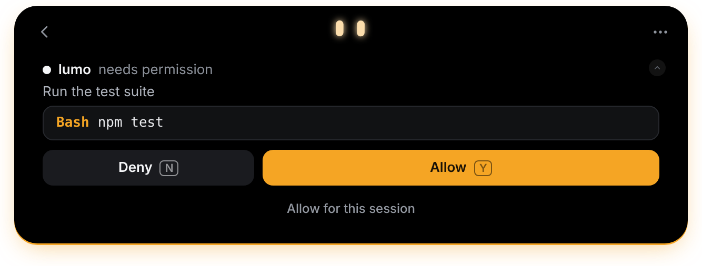</td>
<td width="50%">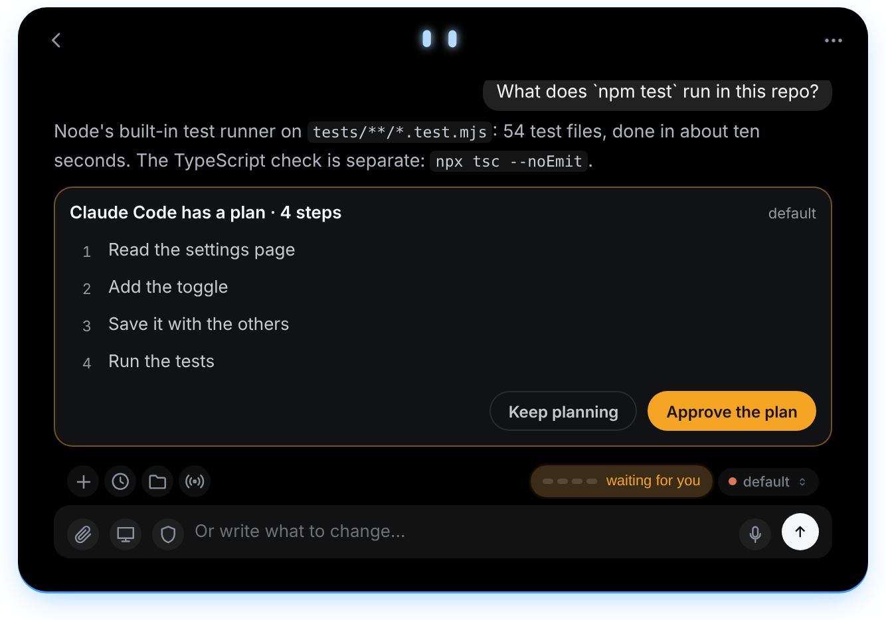</td>
</tr>
</table>

### The chat

- 💬 **Chat with Claude, Google AI (Gemini), OpenAI, OpenRouter, or a local model (Ollama, LM Studio, Unsloth Studio, any OpenAI-compatible server)** — one field, with **+** for the rest and past chats in the top bar; the model's name beside the field switches provider and model. Cloud providers use your own API key.
- 🧠 **Chat with your Claude plan or your ChatGPT account** — pick **Claude Code** or **Codex** and the island talks to the CLI you already use, no API key. An action comes up as an Allow / Deny card exactly when the CLI would ask for it, and **the shield** says how much it may do on its own (Ask every time, Auto, Plan only). Antigravity CLI, Copilot CLI and Cursor CLI work the same way, with your Google, GitHub Copilot or Cursor plan.
- 🏠 **Local models that do real work** — tools, pictures, PDFs and reasoning by what the model can do, a web search that works (Bing with Bing News, no key; with Unsloth Studio, its own search when Lumo has its key), and a folder of copies for each chat: the model works on copies of your files, and a copy goes over the original only with your click. Settings shows the model in memory, frees it with one click and downloads new ones.
- 🐙 **The chat reads your GitHub** — with the GitHub pill set up and Settings → Security → **GitHub** on Read only, every provider can read your pull requests with their checks and reviews, issues, repositories, commits and Actions runs. Off until you turn it on.
- ⌨️ **Commands in the chat** — type `/` and a menu opens: `/new`, `/history`, `/model`, `/effort`, `/attach`, `/screen`, `/permissions`, `/timer`, `/compact`, Claude Code's own commands (`/context`, your skills), Antigravity CLI's (`/usage`, `/credits`, `/skills`) and **your tools**, each with its own command. Only what works with the chosen provider is listed.
- 📏 **The chat's usage as bars** — how full the context is after every answer, what fills it after `/context`, and each limit of your plan.
- 🖼️ **Share what's on your PC** — open windows, screens, browser tabs and folders as pills and tiles; nothing is captured until **Send to the chat**. `Ctrl+Alt+P` asks about the screen, `Ctrl+Alt+X` about the selected text, `Ctrl+Alt+B` about the page in the browser, from any app. The names of the windows and documents you have open go with your question, so "what's this PDF about?" just works (Settings → Security turns it off).
- 📎 **Drop files on the island** — several at once, each with its bar; they fly up to Lumo in the top bar and join the chat.
- 📂 **Chat files** — each chat keeps the files that went with it: what you attached and what Claude Code, Codex or Antigravity CLI read, edited or created, to open again with a click.
- ➗ **Math in answers** — formulas in LaTeX (`$…$`, `$$…$$`, `\(…\)`, `\[…\]`) drawn as real math in Latin Modern Math, the face of LaTeX: fractions, roots, matrices, sums, vectors, over 500 symbols.
- 🎙️ **Talk with Gemini Live** — the microphone in the chat field or `Ctrl+Alt+L`: a spoken call with Gemini Live that looks at your screen when it needs to, reads your files and PDFs, opens files and apps, and asks Claude Code or Antigravity CLI for anything else. Uses your Google AI key.
- 🖱️ **Let Claude use the computer** — a glowing screen edge, Claude's own mouse, and every action approved by you.

<table>
<tr>
<td width="50%">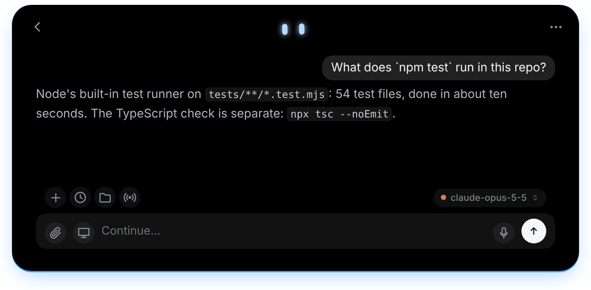</td>
<td width="50%">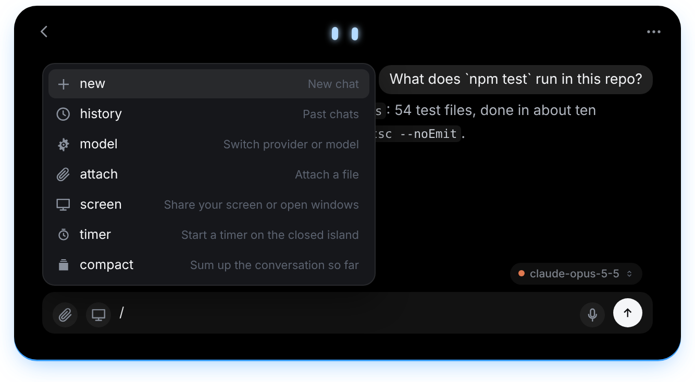</td>
</tr>
<tr>
<td width="50%">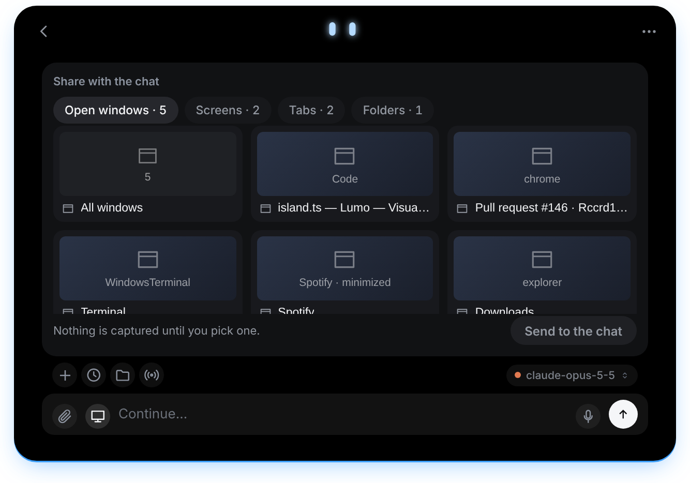</td>
<td width="50%">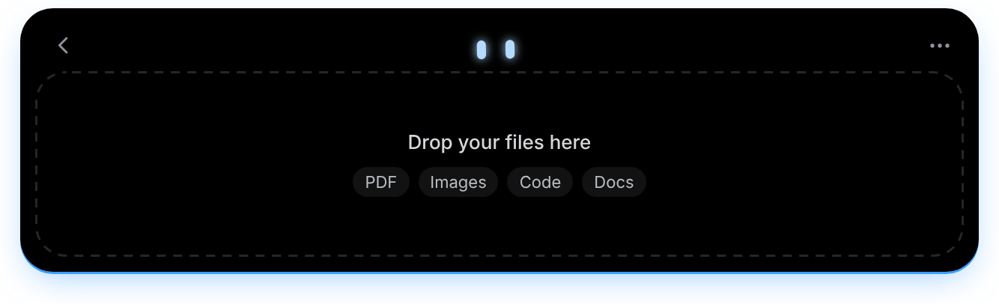</td>
</tr>
</table>

### Tools, listening and your day

- 🛠️ **Your own tools** — small programs Lumo and its agents can use for you: a benchmark of your PC, a report from your app, anything you have a script for. **Add a tool** (right on the home) opens the **tool workshop**, a chat where Lumo writes the tool with you (or brings in a script you already have), tries it on your PC and saves it. Claude Code, Codex, Antigravity CLI, the island chat and the API providers get them.
- 🛡️ **Lumo's supervisor** — every saved or changed tool is read by a second model, which says in plain words what it really does and whether it looks safe, needs reading first or is dangerous (a dangerous tool is turned off). What a tool declared it needs is enforced: no internet, no files outside its folder, no programs unless it said so.
- 👂 **Listening** — Lumo can keep an ear on a GitHub pull request, a file or a folder, a program, a web page, an email, the calendar, your services, Windows, your agents, a webhook or one of your tools, once or every time, and tell you or have the chat act on it.
- ⏱️ **Live activities** — on the home, as tiles: the timer with its ring round the tile's edge, the music playing with its controls, the next events of your calendar, the newest emails. The closed island says what's going on, several things side by side. Any model in the chat or Gemini Live can set a timer.
- ✉️ **Email** — the Email pill reads your inbox from the classic Outlook on your PC (no password) or over IMAP (Gmail, Outlook, iCloud, any server, with an app password), or both: a new email peeks out of the closed island within seconds, with **Summarize** and **Draft a reply**, and opens wide enough to read all of it, scrolling, when the mouse rests on it. Read only unless you allow more in **Settings → Security → Email**, and then each send, reply or move waits for your click on its card. An email's card can be changed before **Send**: who it goes to, Cc, the subject, the text, its files (**Attach** adds more) and, with several accounts, who it is from.
- 🔌 **Integrations** — Email (Outlook or IMAP), Stripe payments, n8n workflows, GitHub (open PRs, reviews requested, CI status, contributions), Vercel deployments, Resend emails, Notion, Cal.com, as pills on the home.
- 📋 **Declare the tools you use** — Settings → Pills & integrations: pick your main tool (VS Code, Cursor, Codex or Antigravity), then up to 4 more agents, chat providers and services.

<table>
<tr>
<td width="50%">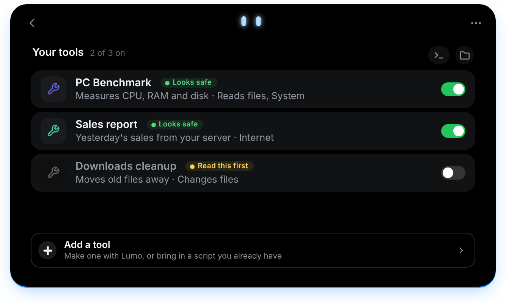</td>
<td width="50%">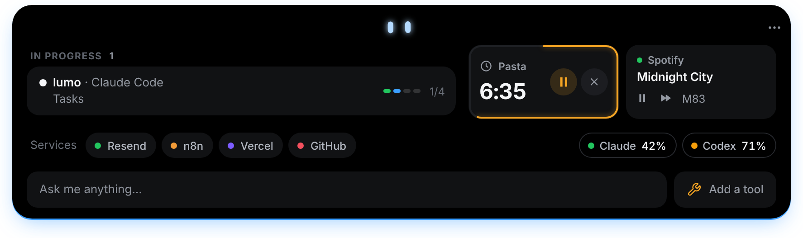</td>
</tr>
</table>

### The island

- 🫥 **Invisible when idle** — hides away when nothing is running, peeks out when you hover the top edge of the screen. Its opening is the island's light coming on.
- 🧲 **Docks anywhere** — drag it to the top, bottom, left or right edge, resize it, zoom it; the home goes narrower than the other views.
- 👗 **The wardrobe** — right-click Lumo and pick the light along the island's edge (Full light, Soft light, Line only, Glow only) and Claude's mouse for computer use.
- ⚙️ **Settings in the island** — the search and the sections on top, always in sight while scrolling.
- ⌨️ **Keyboard shortcuts** — open the chat, jump to an alert or a terminal, switch pills, mute or open the wardrobe from anywhere; all customizable in Settings → Shortcuts.
- 📅 **Weekly recap** — every Monday Lumo sums up the past week: time coding, sessions, files, lines changed, commands, permissions, top agent and project. Share it as a 1080 × 1920 image — project names optional. All local.
- 🌍 **11 languages** — English, 中文, हिन्दी, Español, العربية, Français, বাংলা, Português, Русский, Bahasa Indonesia, Italiano. Settings → General → Language.
- 🔄 **Updates inside the app** — Lumo says when a newer version is out; **Update now** downloads it, installs it without any window and opens the new Lumo by itself. **Beta versions** (off unless turned on in Settings → Updates) let you try what's coming before it's released.
- 🔒 **Private by design** — no telemetry, no account. Keys live in Windows Credential Manager. The app only talks to the services you plug in.

<table>
<tr>
<td width="50%">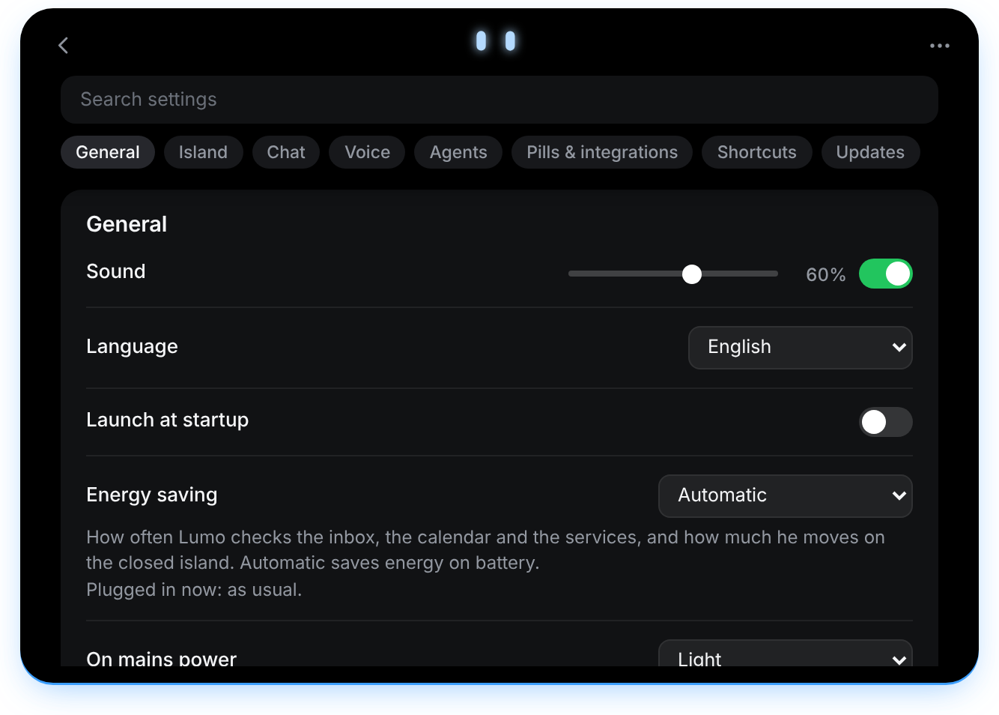</td>
<td width="50%">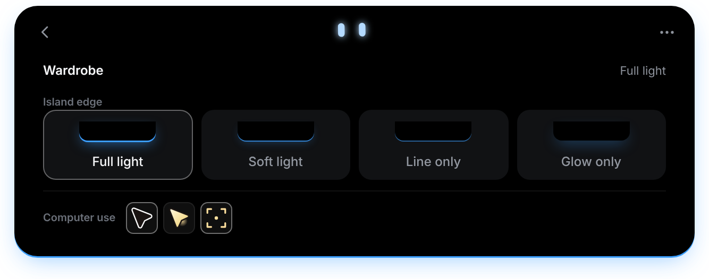</td>
</tr>
</table>

## Versions

Windows builds are in Releases under the `windows-v*` tags; the newest build is always at [`windows-latest`](https://github.com/Rccrd12/Lumo/releases/tag/windows-latest). See [CHANGELOG.md](CHANGELOG.md) for the full notes of each version.

| Windows | Date | Highlights |
|---------|------|------------|
| [0.22.1](https://github.com/Rccrd12/Lumo/releases/tag/windows-v0.22.1) | Nov 12, 2026 | Change an email on its card before Send and attach files, a new email read in full on the closed island, Fable 5.2 in the model pickers, code and formulas set aside before the Markdown and read the same way by the ink and the steps card, `~~~` code blocks in the chat, `[[listen]]` named in a sentence left as written, italic letters no longer cut at a formula's edge, long model names on the closed island, an island that moves smoothly and lands with no jump, a queued Actions run no longer read as checks passed |
| [0.22.0](https://github.com/Rccrd12/Lumo/releases/tag/windows-v0.22.0) | Nov 11, 2026 | Cloud answers (Claude API, OpenAI, Google AI, OpenRouter) stream in with no 4096-token or 90-second cut, and get the effort slider, the context ring and the shield's modes, the function plot as a plane with drag, zoom, notable points and regions, rich cards from local models, permission cards that allow only what they show, Y and N only on a card you turned to, `[[listen]]` asks first, Antigravity CLI's own permission mode, updates signed by Lumo, chat tools that ask before they act, images from other sites only after a click, more cards where a page or a file could steer the AI, an error card that says what went wrong, an island that fits what it shows, email never sent twice, chat programs that end with Lumo, TLS security fixes |
| [0.21.0](https://github.com/Rccrd12/Lumo/releases/tag/windows-v0.21.0) | Nov 10, 2026 | Rich cards in the chat's answers (callouts, steps, side-by-side cards, calculator and function plot, quiz, data chart, timeline, checklist, diff) and images from the web, answers written in ink, Copy, Retry, Edit and when under each message, permissions and a Windows sandbox for local models, which also plan on their own, Outlook read with no security prompt, usage orange from 75 % and red from 90 %, one look (the one from before 0.18 gone, with the outfits, Lumo's other styles and the live activities' and the plan's own windows), Copilot CLI's and Cursor CLI's deletions and moves named on their cards, the agents' sign-ins never read by Gemini Live nor copied into a chat's folder, no update without GitHub's SHA-256, releases scanned with Microsoft Defender, Unsloth Studio ends with Lumo even after a crash |
| [0.20.1](https://github.com/Rccrd12/Lumo/releases/tag/windows-v0.20.1) | Nov 9, 2026 | Sessions another program starts in the background share one row, with no sound or alert for each (`LUMO_BACKGROUND`, `LUMO_BATCH_TOTAL`), sounds at most once every 1.5 s, your questions in Markdown and TeX like the answers, each Unsloth Studio model once in the picker |
| [0.20.0](https://github.com/Rccrd12/Lumo/releases/tag/windows-v0.20.0) | Nov 8, 2026 | A card answered in the terminal goes away, Claude Desktop's, Antigravity's and OpenCode's requests on the island, email from the classic Outlook on the PC with no password and from several IMAP accounts, Copilot CLI and Cursor CLI in the chat, Security in a tab of its own, sessions by their title, approve a plan and let it edit files, `CLAUDE_CONFIG_DIR`, Unsloth Studio started and stopped by itself, open PRs that only wait in one row on the home, updates checked against GitHub's SHA-256 |
| [0.19.1](https://github.com/Rccrd12/Lumo/releases/tag/windows-v0.19.1) | Nov 8, 2026 | Menus with their text centred, and no beta offered when it holds nothing the release does not |
| [0.19.0](https://github.com/Rccrd12/Lumo/releases/tag/windows-v0.19.0) | Nov 8, 2026 | The chat reads your GitHub (off until turned on in Security), the Plan island for every provider, chats at work on the home, Unsloth Studio loads and frees its models better, beta versions in Settings → Updates |
| [0.18.0](https://github.com/Rccrd12/Lumo/releases/tag/windows-v0.18.0) | Nov 8, 2026 | A new look (the previous one a switch away in Settings): Lumo's eyes in the top bar, one home instead of the tabs, plans that show their steps when they ask to start, usage and sharing as bars and tiles |
| [0.17.1](https://github.com/Rccrd12/Lumo/releases/tag/windows-v0.17.1) | Nov 7, 2026 | Formulas in Latin Modern Math, on the chat's background; answers with room between their lines; the minus on the fraction's line |
| [0.17.0](https://github.com/Rccrd12/Lumo/releases/tag/windows-v0.17.0) | Nov 7, 2026 | Local models with tools, pictures and a folder of copies for each chat; Unsloth Studio; PDFs for every model; Lumo's own web search; `/compact` for API providers; formulas as MathML; several files dropped at once |
| [0.16.1](https://github.com/Rccrd12/Lumo/releases/tag/windows-v0.16.1) | Oct 29, 2026 | A width for the closed island alone; fewer words on the closed island; Lumo alone in a short pill during computer use |
| [0.16.0](https://github.com/Rccrd12/Lumo/releases/tag/windows-v0.16.0) | Oct 29, 2026 | Listening to pull requests, files, programs, pages, email, services, Windows, agents, webhooks and your tools; a Security section; more email powers on cards; a new computer use look |
| [0.15.0](https://github.com/Rccrd12/Lumo/releases/tag/windows-v0.15.0) | Oct 25, 2026 | The session's steps fill the overview card and open up; your tools with Antigravity CLI and Codex; Antigravity CLI's `/usage`, `/credits`, `/skills` and `/compact` |
| [0.14.0](https://github.com/Rccrd12/Lumo/releases/tag/windows-v0.14.0) | Oct 23, 2026 | `/context` as a compact card; tables in the answers; a tidier "/" menu with `/effort`; Update now with the .msi |
| [0.13.2](https://github.com/Rccrd12/Lumo/releases/tag/windows-v0.13.2) | Oct 23, 2026 | Formulas in the chat: tall brackets around matrices, aligned columns, vector arrows; Claude Code's commands run even with what's open shared |
| [0.13.1](https://github.com/Rccrd12/Lumo/releases/tag/windows-v0.13.1) | Oct 22, 2026 | Attachments and Chat files keep their place when switching; Chat files show their folder |
| [0.13.0](https://github.com/Rccrd12/Lumo/releases/tag/windows-v0.13.0) | Oct 22, 2026 | Commands in the chat with a "/" menu, your tools included; Codex as a chat provider with your ChatGPT account; Chat files; local models' memory; Update now installs without a window |
| [0.12.0](https://github.com/Rccrd12/Lumo/releases/tag/windows-v0.12.0) | Oct 22, 2026 | Tools tab: your own tools for Lumo and its agents, made in the tool workshop and read by Lumo's supervisor; Allow for this session on permission cards; email reconnects within seconds |
| [0.11.1](https://github.com/Rccrd12/Lumo/releases/tag/windows-v0.11.1) | Oct 20, 2026 | The island opens on the chat at startup again; deleting a chat drops its plans |
| [0.11.0](https://github.com/Rccrd12/Lumo/releases/tag/windows-v0.11.0) | Oct 16, 2026 | The Plan island behaves as the live activities; Antigravity CLI moves its plan on step by step |
| [0.10.1](https://github.com/Rccrd12/Lumo/releases/tag/windows-v0.10.1) | Oct 16, 2026 | The island chat's Claude Code and Antigravity CLI write their plan, and the Plan island follows its steps |
| [0.10.0](https://github.com/Rccrd12/Lumo/releases/tag/windows-v0.10.0) | Oct 16, 2026 | The Plan island joins the island again, keeps finished plans and gets a new look; the chat no longer scrolls on its own |
| [0.9.2](https://github.com/Rccrd12/Lumo/releases/tag/windows-v0.9.2) | Oct 16, 2026 | The Plan island follows the island chat's plan with the newest Claude models too |
| [0.9.1](https://github.com/Rccrd12/Lumo/releases/tag/windows-v0.9.1) | Oct 16, 2026 | The Plan island also follows the plan of Claude Code in the island's own chat |
| [0.9.0](https://github.com/Rccrd12/Lumo/releases/tag/windows-v0.9.0) | Oct 16, 2026 | A Plan island that follows the agent's plan live, the changelog in Settings and a note when a newer Lumo is out, Antigravity CLI reading email, usage pills for every agent, an island that reopens on its tab, detached live activities that stay open |
| [0.8.0](https://github.com/Rccrd12/Lumo/releases/tag/windows-v0.8.0) | Oct 15, 2026 | Gemini Live changes settings, arranges windows, tidies files and sets reminders, and answers from what Lumo knows; Y and N answer a permission from the chat field; an island that stays on top and waits while you write |
| [0.7.0](https://github.com/Rccrd12/Lumo/releases/tag/windows-v0.7.0) | Oct 13, 2026 | Antigravity CLI quotas in the header and the chat, a calendar that rides out a bad network, a drop zone that closes when the file goes elsewhere, about 30 fixes from a full code review: computer use, permission cards, the relay, the calendar, Gemini Live; Remove buttons for integration keys |
| [0.6.4](https://github.com/Rccrd12/Lumo/releases/tag/windows-v0.6.4) | Oct 12, 2026 | Permission requests that wait in line, several sessions sharing a pill, Energy None asking more often, about 2,500 lines of unused code removed |
| [0.6.3](https://github.com/Rccrd12/Lumo/releases/tag/windows-v0.6.3) | Oct 12, 2026 | Listening mode that starts however the line is written, a chip in the chat to see and stop it, no hit on GitHub's rate limit |
| [0.6.2](https://github.com/Rccrd12/Lumo/releases/tag/windows-v0.6.2) | Oct 12, 2026 | Y and N answer a permission card that says what it is for, Auto for Antigravity CLI, every chat control usable mid-answer with answers going on in their own chat, no more waiting commands for GitHub, a dropped file joins the open chat, shorter Settings descriptions |
| [0.6.1](https://github.com/Rccrd12/Lumo/releases/tag/windows-v0.6.1) | Oct 11, 2026 | Listening mode that no longer misses its line, listening mode for Antigravity, a sent screenshot no longer blocks the next message, the upload ending on the full bar |
| [0.6.0](https://github.com/Rccrd12/Lumo/releases/tag/windows-v0.6.0) | Oct 11, 2026 | Windows only (Linux dropped), drop a file on any island size straight into the chat, the upload carried on with the island closed, a listening mode for GitHub pull requests, no time limit on Claude Code turns |
| [0.5.8](https://github.com/Rccrd12/Lumo/releases/tag/windows-v0.5.8) | Oct 11, 2026 | One row per attachment (two screenshots of the same screen too), the attachments folder made anew, the big picture over the whole island with Lumo aside, the upload bar centred |
| [0.5.7](https://github.com/Rccrd12/Lumo/releases/tag/windows-v0.5.7) | Oct 11, 2026 | Several screenshots, selections and files with one question, service cards laid out like the tools', Lumo waits under the dragged file, the big preview beside Lumo |
| [0.5.6](https://github.com/Rccrd12/Lumo/releases/tag/windows-v0.5.6) | Oct 11, 2026 | Ctrl+Alt+B attaches a PDF open in the browser as the file, attachments in a folder beside the past chats, GitHub keeping up on the closed island, gentler chat scrolling, a drop that follows the file, big previews |
| [0.5.5](https://github.com/Rccrd12/Lumo/releases/tag/windows-v0.5.5) | Oct 11, 2026 | Energy saving (None, Light, Automatic on battery, On) with a leaf on the closed island, a – that hides the island into its edge, the hidden island comes back again, a left click on the tray icon hides or shows it |
| [0.5.4](https://github.com/Rccrd12/Lumo/releases/tag/windows-v0.5.4) | Oct 11, 2026 | The chat stays put when scrolled up during an answer, every agent at work (VS Code, Cursor, Codex…) and GitHub's CI on the closed island, the screen attached without sending, promotional emails hidden |
| [0.5.3](https://github.com/Rccrd12/Lumo/releases/tag/windows-v0.5.3) | Oct 11, 2026 | Browser tabs shared on Windows (read from Edge and Chrome themselves), Ctrl+Alt+B asks about the page in the browser, a click on a chip shows exactly what goes, a search in Settings |
| [0.5.2](https://github.com/Rccrd12/Lumo/releases/tag/windows-v0.5.2) | Oct 11, 2026 | Claude uses your computer — a glowing screen, its own orange mouse, every action approved — also for Gemini Live; share windows and browser tabs with what they show; Settings from the right-click menu inside the island |
| [0.5.1](https://github.com/Rccrd12/Lumo/releases/tag/windows-v0.5.1) | Oct 10, 2026 | Allow and Deny from the closed island and for the chat's Claude Code, the Claude plan's 5 hours from Anthropic, a right-click menu with Refresh, past sessions and a search in the past chats, the usage ring in the chat, Live Activities that follow the island |
| [0.5.0](https://github.com/Rccrd12/Lumo/releases/tag/windows-v0.5.0) | Oct 9, 2026 | Live activities (timers, music, calendar, email) on the closed island and beside the open one, the Email pill, the chat knows what's open on your PC, math in answers, Italiano, Lumo's own names everywhere |
| [0.4.0](https://github.com/Rccrd12/Lumo/releases/tag/windows-v0.4.0) | Oct 9, 2026 | Talk with Gemini Live, which sees your screen, reads your files and asks Claude Code for help; Lumo animates every state; the wardrobe in two parts |
| [0.3.2](https://github.com/Rccrd12/Lumo/releases/tag/windows-v0.3.2) | Oct 9, 2026 | Antigravity CLI answers in the chat, an effort slider, a permissions button in the chat, a centred launch greeting, the app is lumo.exe |
| [0.3.1](https://github.com/Rccrd12/Lumo/releases/tag/windows-v0.3.1) | Oct 8, 2026 | Now called Lumo, settings inside the island, a floating island that docks near the edges, choose how it opens and closes, it no longer disappears on its own |
| [0.3.0](https://github.com/Rccrd12/Lumo/releases/tag/windows-v0.3.0) | Oct 8, 2026 | Chat with your Claude plan through Claude Code, your screen on request, an island that docks on any edge and resizes, Settings in sections with updates |

## Install

### Windows

Download **[Lumo-Windows.msi](https://github.com/Rccrd12/Lumo/releases/download/windows-latest/Lumo-Windows.msi)** or **[Lumo-Windows-setup.exe](https://github.com/Rccrd12/Lumo/releases/download/windows-latest/Lumo-Windows-setup.exe)** (Windows 10/11, always the newest version) and run it. You can also [build it from source](#build-from-source).

**Windows will show a warning the first time — that's expected.** The installer isn't code-signed yet, so SmartScreen doesn't know the publisher:

1. A **"Windows protected your PC"** screen appears, with *Publisher: Unknown publisher*.
2. Click **More info** (*Informations complémentaires* in French). This reveals a **Run anyway** button.
3. Click **Run anyway** (*Exécuter quand même*). The installer starts normally.

This is only because the app isn't signed with a paid certificate yet. Lumo is open source, and Microsoft Defender scans the installer as clean.

**Settings… → Updates → Check for updates** looks for the newest `windows-v*` release of this repository, only when you click it.

There is no notch on a PC, so the island slides out of the top edge of the screen
instead of hiding inside one. See [`windows/README.md`](windows/README.md) for the
rest of the differences.

### Build from source

Requirements: [Rust](https://rustup.rs), Node 22.18+, MSVC build tools.

```powershell
git clone https://github.com/Rccrd12/Lumo.git
cd Lumo/windows
npm install
npm run tauri dev           # live-reloading development build
npm run pack                # installer lands in windows/release/
```

## Setup

Click the Lumo icon in the system tray → **Settings…**

| What | Why | Where the key goes |
|---|---|---|
| **Claude Code hooks** | live sessions and approvals | Settings → Agents → Claude Code → **Install hooks** — Lumo backs up `~/.claude/settings.json`, merges its hooks and shows you the diff before writing anything |
| **Other agents** | their sessions in the island | Settings → Agents, same backup, diff and confirmation |
| **Plan usage** | Claude, Codex and Antigravity CLI limits in the island's header | Settings → Agents → Plan usage |
| **Anthropic API key** | chat and questions about files | Settings → Chat → Claude · Windows Credential Manager |
| **Google AI, OpenAI, OpenRouter keys** | chat with other providers | Settings → Chat → Chat providers · Windows Credential Manager |
| **Local models** | chat with Ollama, LM Studio or an OpenAI-compatible server | Settings → Chat → Local models |
| **Email** | new emails on the island, the newest in the live activities | Settings → Pills & integrations → Email: **Outlook on this PC** (the classic Outlook, nothing to type) and/or **IMAP**, one or more accounts, each with address, IMAP server and an app password · Windows Credential Manager |
| **Calendar** | the next events in the live activities and on the closed island | Settings → Island → Calendar: your calendar's secret iCal address · Windows Credential Manager |
| Stripe, n8n, GitHub, Vercel, Resend, Notion, Cal.com | the service pills | Settings → Pills & integrations · Windows Credential Manager, all optional |

If Lumo isn't running, the hook exits immediately: **Claude Code is never blocked.**

The full list of supported agents, what each one installs and how it answers is in [`windows/README.md`](windows/README.md#supported-agents).

## Shortcuts

| Do this | Lumo does that |
|---|---|
| Move the mouse to the very top-centre of the screen | peeks out and says hi 👋 |
| Click the small island | opens |
| Click Lumo | annoyed for a moment |
| Right-click Lumo | the wardrobe |
| Drag files onto the island | it opens, takes them and sends them up to Lumo, into the chat |
| `Ctrl+Alt+Space` | opens the chat, from any app |
| `Ctrl+Alt+P` / `Ctrl+Alt+X` | asks about your screen / the selected text |
| `Ctrl+Alt+L` | talks with Gemini Live |
| `Ctrl+Alt+A` | jumps to the waiting permission or question |
| `Ctrl+Alt+T` | brings the session's window forward |
| `Ctrl+Alt+→` / `Ctrl+Alt+←` | next / previous pill |
| `Ctrl+Alt+S` | mutes or unmutes Lumo |
| `Ctrl+Alt+G` | opens the wardrobe |
| `Esc` | closes the island |

Every global shortcut can be changed or turned off in **Settings… → Shortcuts**.

## How it works

- A [Tauri 2](https://tauri.app) app (Rust + TypeScript): the island is a transparent, always-on-top window that never steals focus; Lumo is drawn in Canvas 2D, with no images.
- Claude Code and the other agents' hooks go through a tiny `lumo-hook` relay over a named pipe. For approvals it waits for your click, and gives up within moments if the app doesn't answer.
- Integrations are lightweight pollers, paused when nothing is watching.
- Details in [`windows/README.md`](windows/README.md).

## Privacy

- No telemetry, no account. The only update check is one request to GitHub when Lumo opens (off in Settings → Updates), and nothing is downloaded without your click.
- Keys live in Windows Credential Manager, never on disk and never in the interface.
- The only network requests Lumo makes are to the services you configure yourself, and to the sites of the images in chat answers: such an image is downloaded by Lumo at once (https and public addresses only, image files only, 8 MB at most), and the site sees your IP address and the image's full address, which the AI writes and could fill with words from your chat. The pictures an email links to, in the island's Email view, are downloaded the same way only after a click on Load images (or at once, if you turn on Settings → Security → Email images always), and the sender's site then learns that you opened the email; the tracking pixels Lumo recognises are never downloaded. Settings → Security → Images from the web turns both off.
- Screenshots are taken only when you ask, and shown to you before anything is sent. The names of the windows and documents you have open go with a chat question unless you turn it off in Settings → Security, where you also choose whether the AI may read your email and calendar.
- Email and the calendar are only read unless you allow more in Settings → Security; then every email sent, moved or deleted waits for your click on its card. GitHub reaches the chat only once you turn it on there.
- The log and the weekly recap history stay on your machine.

## Contributing

Issues and PRs are welcome. See [CONTRIBUTING.md](CONTRIBUTING.md).

## Credits

Lumo is a fork of [Louis-CFM/coucou](https://github.com/Louis-CFM/coucou), the Coucou app created by [Louis Raillé](https://louisraille.fr).

## License

- **Code:** [MIT](LICENSE) — use it, fork it, learn from it, just keep the copyright notice.
- **The name Lumo, the Lumo character, its icon, sounds and screenshots:** © Riccardo Gentili, all rights reserved — see [LICENSE-ASSETS.md](LICENSE-ASSETS.md).
- **The names Coucou and Mochi, the Mochi character and Coucou's icon, sounds and media:** © Louis Raillé. That is why this fork has a name and a character of its own.
