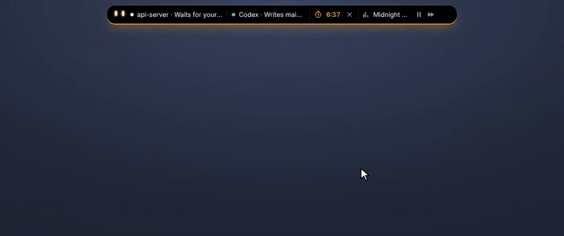
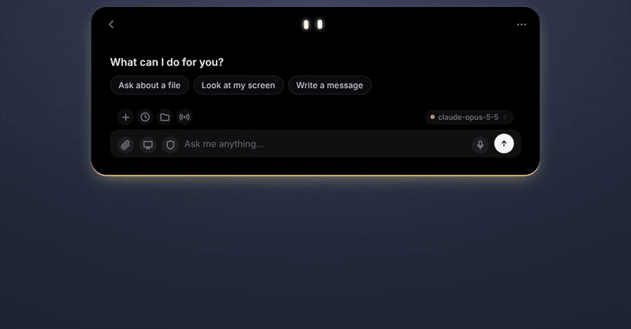

<div align="center">


# Lumo

**A little light at the top of your Windows screen that tells you what your AI agents are doing, and lets you answer them without switching windows.**

[](https://github.com/Rccrd12/Lumo/releases)


**[Download for Windows](https://github.com/Rccrd12/Lumo/releases/download/windows-latest/Lumo-Windows-setup.exe)** · [Full guide](windows/README.md) · [What's new](CHANGELOG.md)


</div>

## What is it?

You start Claude Code, Codex or another AI agent, then go do something else. Lumo sits at the top of the screen as a small island with two eyes: it shows what the agent is doing, lights up when the agent needs you, and lets you answer with one click (or `Y` / `N`) from wherever you are.

## What it does

### 👀 See every agent at work

Claude Code, Codex, Copilot CLI, Antigravity, Cursor, OpenCode, Amp and more, each session on one home with what it reads, edits and runs, and a green **Done** when it finishes. Timers, music, your calendar and email sit beside them.



### ✅ Approve without switching windows

Permissions, questions and plans come up as a card. **Allow** or **Deny** with a click; nothing is ever allowed without it.


### 💬 Chat with any AI

Claude, Gemini, ChatGPT, OpenRouter or a model on your own PC, with an API key or the Claude, ChatGPT or Google plan you already have. Drop files, share your screen, and get charts, formulas and checklists right in the answer.



### …and more

Your own tools for the agents · Lumo listening to a pull request, a file or a web page · a voice call with Gemini Live · Claude using the computer, every action approved · 11 languages. All in the **[full guide](windows/README.md)**.

## Install

1. Download **[Lumo-Windows-setup.exe](https://github.com/Rccrd12/Lumo/releases/download/windows-latest/Lumo-Windows-setup.exe)** (Windows 10/11, always the newest version) and run it.
2. Windows may say *"Windows protected your PC"*: click **More info**, then **Run anyway**. The installer isn't code-signed yet; Lumo is open source and Microsoft Defender scans it as clean.
3. Click the Lumo icon in the system tray → **Settings…** → **Agents** → **Claude Code** → **Install hooks**. Lumo shows you the change to `~/.claude/settings.json` and backs it up before writing.

Start Claude Code and watch the island. Other agents, chat providers and services are set up in the same Settings ([how](windows/README.md#supported-agents)).

<details>
<summary>Build from source</summary>

Requirements: [Rust](https://rustup.rs), Node 22.18+, MSVC build tools.

```powershell
git clone https://github.com/Rccrd12/Lumo.git
cd Lumo/windows
npm install
npm run tauri dev           # live-reloading development build
npm run pack                # installer lands in windows/release/
```

</details>

## Private by design

- No telemetry, no account. Keys live in Windows Credential Manager, never on disk.
- Lumo talks only to the services you set up (and, once when it opens, to GitHub to check for updates).
- If Lumo isn't running, Claude Code is never blocked.

Everything Lumo sends and keeps: [Privacy](windows/README.md#privacy).

## Learn more

- **[Full guide](windows/README.md)**: every feature, setting and shortcut
- **[What's new](CHANGELOG.md)**: the notes of every version
- **[Add your agent](docs/AGENTS.md)**: the hook protocol
- **[Contributing](CONTRIBUTING.md)**

## Credits and license

Lumo is a fork of [Louis-CFM/coucou](https://github.com/Louis-CFM/coucou), the Coucou app created by [Louis Raillé](https://louisraille.fr).

Code under [MIT](LICENSE). The name Lumo, its character, icon, sounds, screenshots and videos © Riccardo Gentili, all rights reserved ([LICENSE-ASSETS.md](LICENSE-ASSETS.md)). The names Coucou and Mochi, the Mochi character and Coucou's icon, sounds and media © Louis Raillé.
